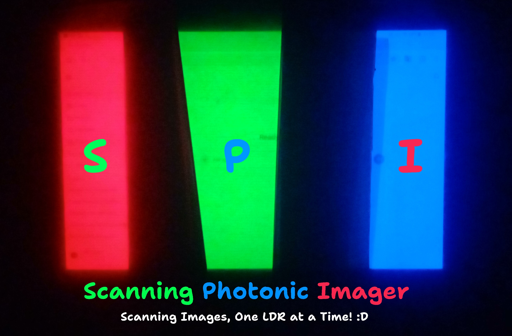

# Scanning-Photonic-Imager (SPI)

    

(An Experimental Arduino-based Project i am currently in the process of Making...)

**STATUS: In-Progress**

## Initial Overview
**SPI (Scanning Photonic Imager)** is an experimental Arduino-based imaging Project that constructs images by scanning a scene with a mechanically moving light sensor.
The (Initial) goal is to explore how an image can be constructed using a Single Set of Light sensors.

## Backstory
Around a year ago, I was opening up my Android phone to fix some issue with it, When i happened to remove one of its cameras and was kinda amazed at how small the thing that gives "Eyesight" to my phone was.

I already had a crude idea about how Modern Screens show stuff using Millions of Sets of RGB LEDs, So i tried to follow the same logic backwards and figured that it should also be possible to use Millions of Sets of RGB Light Sensors to construct images (A Crude Camera, so to speak). And surprise surprise, that's (mostly) how modern cameras work too!

So, I jotted down the idea in my "Ideas list" and basically forgot about it for a while, When just some weeks later, I found myself scrolling that same list and saw the idea for this project again.

Now, Me being an amateur hobbyist, I cannot work with Millions or even Thousands of Light Sensors in arrays (Money and skill issue, I know) + I didn't wanna use an actual Camera sensor, as that would defeat the entire point of testing this idea...

Then i thought of using just a Single Set/Array of Light sensors and physically move it in a way to scan the required Field of View (FOV) of the scene, Cause a Single Set of Light sensors would be incredibly cheap to work with.
The only downside was that constructing an image this way would take much more time than a Normal Sensor would, But as a proof of concept, Time taken per image is no constraint at all! (It could take years to make one and i wouldn't care less! Ok, not that long...)
So Servos also became a part of the project this way (Forcing me to study a bit of Inverse Kinematics :/)

I eventually committed to making the project a reality (And had to make way too many visits to the hardware store to buy the components for it)

**And hence SPI was born!**

Fun fact: I came up with the name Scanning Photonic Imager by basically combining the use case of this project with the name of the Scanning Electron Microscope :D

(I apologize for the long yap of a Backstory i just unleashed here btw)

----
## How SPI Works
- The main Light sensing is done by an Array of LDR's. There will be (Current Plan) 7 LDRs. 2 Red, 2 Green, 2 Blue and 1 Luminance (Colour Neutral LDRs to judge overall Exposure)

- The Computer and Nano will be talking continuously. The computer will send a defined set of Co-ordinates/Servo Angles calculated by user defined Parameters like Image Resolution (For ex. 16x16/32x32).
The computer further will send Servo Motor angles (According to the Resolution and some other Pre-Defined Parameters) to the Nano
The Nano will then move the Servos according to the Specific angles

- Once the Servos have reached the defined Position, The Nano will take 200 Voltage ADC Readings from each LDR and then Average them out into 1 Reading per LDR.
The Nano will send all the 7 Readings of the LDRs to the Computer (From the Averaged 7 LDRs).

- The Computer then will write the received data into a CSV file
The Computer will then command the Nano to move the Servos to the Next position to "Paint" the next Pixel in the image

- This process will loop until all the Pixels of the defined image are Painted

- After the "Painting" process is complete, The Nano will send the 'Image Complete' signal to the Computer.
The Computer will then use Python and Pillow (A Python Library) to "Paint" an image pixel-by-pixel using the data in the CSV file and then will output a .jpg/.png file.

And we will (Hopefully) have an Image of the Scene using just LDRs as the Light Sensors!! :D

## Repo Index
- **You can get more info on the project from the `Docs` folder**
- **All the code files used in this Project are available in the `Code` folder**
- **Experiment Notes, Experiment Results, Circut Diagrams, etc from the completed "Tests" are available in the `Experiments` folder**

## Currently Working on
**4. Calibrating the Light sensors for the Colour Filters**

## Current Roadmap
1. [x] Get the Necessary Components
2. [x] Perform a PreLiminary Light Sensor Sensitivity Test
3. [x] Test Filtering response of the Colour Filters
4. [ ] Calibrate the Light sensors for RGB Colour Detection
5. [ ] Write the Python program to construct an image
6. [ ] Capture the first Pixel
7. [ ] Implement X-Axis movement
8. [ ] Scan a 1-D Array of Pixels
9. [ ] Implement Y-Axis movement
10. [ ] Scan a 2-D Array of Pixels
11. [ ] Produce the First Grayscale Image
12. [ ] Produce the First Coloured Image
13. [ ] Implement Depth Scanning
14. [ ] Implement UV and IR Scanning

More to come soon...

## License
This project is licensed under the MIT License. 
Suggestions, Ideas, and Feedback are always Welcome! :)

**_Thanks a ton for your time! :D_**